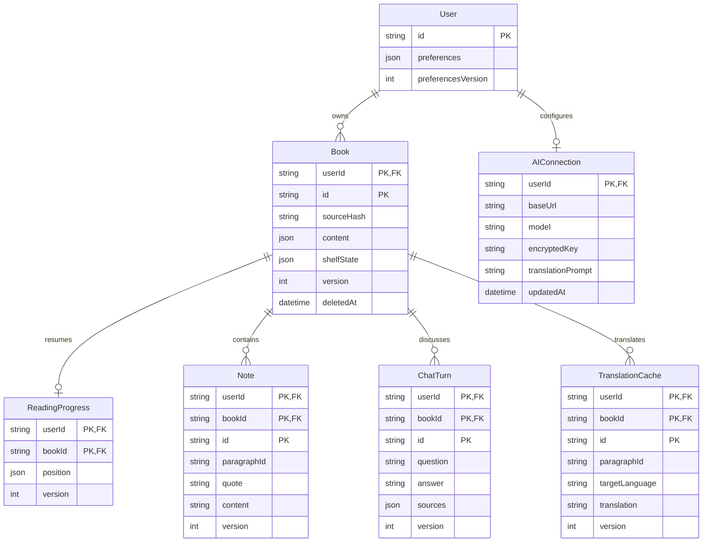

# Architecture

## Application boundaries

The application uses Next.js App Router and TypeScript. The shared root layout provides fonts, metadata, Tailwind theme tokens, an identity boundary, account sync, and a client-side library provider. The home, bookshelf, discovery, book details, notes, profile, and settings have separate routes; `/read/[bookId]` hosts the client-only reading surface. shadcn/ui primitives backed by Radix provide dialogs, inputs, buttons, tabs, sliders, toggle groups, and selects. Next.js route handlers serve same-origin AI, account, session and sync APIs, with Host/Origin checks in `src/proxy.ts`. Auth.js handles Google OAuth; Prisma/PostgreSQL persists users, provider bindings and hashed database sessions. See [authentication](authentication.md) for setup, revocation and data boundaries.

```text
EPUB / TXT -> browser parser -> structured chapters and stable paragraph IDs
                                  |
                           IndexedDB book store
                                  |
                   reader / notes / translation cache
                                  |
Question -> scope selection -> optional multilingual query expansion
                                  |
                    local lexical retrieval + context budget
                                  |
                      localhost /api/ai proxy
                                  |
                    configured Chat Completions service
                                  |
                     SSE answer + source reference buttons
```

## Source layout

| File                                              | Responsibility                                                                         |
| ------------------------------------------------- | -------------------------------------------------------------------------------------- |
| `src/app/layout.tsx`, `src/app/page.tsx`          | App Router shell, metadata, and page entry                                             |
| `src/app/globals.css`                             | Tailwind v4 theme tokens, paper/night themes, and base accessibility styles            |
| `src/app/library.css`, `src/components/library/`  | Responsive non-reading surfaces, route navigation, library and local profile workflows |
| `src/lib/catalog.ts`                              | Original readable discovery catalog and metadata; not a remote bookstore               |
| `src/lib/library-state.ts`                        | Local shelf status, pinning, grouping, reversible hiding, and reader profile           |
| `src/lib/reading-backup.ts`                       | Versioned book/note/position backup validation                                         |
| `src/components/reader/reader-client.tsx`         | Browser-only loading boundary for local data and viewport state                        |
| `src/components/reader/reader.tsx`                | Reader, notes, library, progress, and AI orchestration                                 |
| `src/components/reader/reading-controls.tsx`      | Responsive overlay panels and reading appearance controls                              |
| `src/components/reader/reader-dialogs.tsx`        | Shared dialogs, model settings, and safe answer rendering                              |
| `src/components/ui/`                              | Theme-adapted shadcn/ui primitives                                                     |
| `src/lib/import.ts`                               | ZIP/EPUB metadata and spine extraction, XHTML-to-text, TXT import                      |
| `src/lib/storage.ts`                              | IndexedDB transactions and non-secret preferences                                      |
| `src/lib/ai.ts`                                   | API requests, SSE parsing, context selection, translation cache keys                   |
| `src/lib/useAutomaticTranslation.ts`              | Viewport queue, cancellation, limited retries, and background translation              |
| `src/lib/sample.ts`                               | Original example text and clearly labeled preset translation                           |
| `src/app/api/ai/route.ts`, `src/lib/server/ai.ts` | Streaming model proxy, limits, and server-side prompting                               |
| `src/app/api/config/route.ts`                     | Non-secret provider configuration                                                      |
| `src/proxy.ts`                                    | Loopback Host/Origin checks and security headers                                       |
| `scripts/serve.mjs`                               | Loopback Next.js launcher, `.env` port, and telemetry opt-out                          |

The application still uses React as required by Next.js and shadcn/ui. The previous standalone SPA entry and stylesheet have been replaced by App Router and Tailwind utilities. `ssr: false` keeps browser-only APIs out of server prerendering; IndexedDB upgrades add stores without removing legacy data, and the localStorage keys and origin are preserved. Production assets are built into `.next/`.

Framework references: [Next.js SPA migration](https://nextjs.org/docs/app/guides/single-page-applications), [Tailwind with Next.js](https://tailwindcss.com/docs/installation/framework-guides/nextjs), [shadcn/ui](https://ui.shadcn.com/docs/installation/next).

The reading surface keeps its width when contents, notes, or AI panels open. Desktop tools sit outside the page; mobile chrome overlays the page and can be hidden without reflow. The appearance panel uses Radix-backed shadcn Dialog, Slider, Select, and ToggleGroup components. Typography preferences extend the existing settings key with backward-compatible defaults; paragraph IDs remain stable across devices.

Reader tools now use one active-tool state. Note composition, language mode, typography, and progress have separate panels; secondary settings return to their originating tool. Selection uses native selection-change events; opening AI keeps the selected context without sending a request. Citation navigation retains a return anchor and companion scroll position. Panel focus and mobile visual-viewport handling are documented in [reader interaction changes](design-research/reader-interactions.md).

## EPUB processing

The importer reads `META-INF/container.xml`, then the OPF manifest and spine. It processes linear text chapters in spine order, ignoring the navigation document. Paragraphs receive IDs such as `2.7`, identifying chapter 2, paragraph 7. Book identity is a SHA-256 digest of the original bytes, so repeated imports reuse the same local book ID.

The importer extracts text instead of rendering supplied HTML. Book scripts, styles, SVG, math, frames, and objects are discarded; React escapes the remaining text. Long blocks are split into bounded sources. ZIP extraction checks original entry sizes before accepting entries. The declared EPUB cover may be retained as a local JPEG, PNG, or WebP data URL, capped at 2 MB. Original styling and inline book images are not persisted. A missing cover does not block text import.

## Storage

Guest database `ai-read` and existing data are preserved. Signed-in identities use `ai-read:user:<UUID>`. Schema v2 keeps the original stores and adds synchronization metadata:

- `books`: parsed book structure, keyed by book digest.
- `positions`: current chapter, paragraph, paragraph offset, and furthest opened chapter.
- `notes`: quote and optional user-authored note, grouped by book.
- `translations`: automatic output keyed by language, paragraph, and provider/model fingerprint.
- `chats`: the latest 30 question/answer pairs, for rendering and context selection.
- `turns`: independently synchronized question/answer pairs.
- `sync`: server versions, last acknowledged values and coalesced pending mutations.
- `sync-recovery`: local snapshots retained before a conflicting progress update or remote book deletion.
- The old `glossaries` store is left untouched for data preservation; it has no active UI, prompt or sync role.

Local content and pending sync mutations commit in the same IndexedDB transaction. Shelf metadata and non-secret preferences remain in scoped localStorage and are reconciled on startup. Writes resolve after their transaction completes. Cross-tab signals carry no book content or credentials. Signed-in AI connections live in PostgreSQL, with API keys encrypted by AES-256-GCM using a server-only master key. Local mode without accounts keeps manually entered keys in memory until reload. Interface language stays device-local. The shelf’s hide action preserves reading assets.

The data page exports the existing versioned backup of parsed books, covers, notes and positions. Restore validates the complete input, preserves existing books/positions and merges missing note IDs. The recovery export uses the same format. Conversations, translation caches, original files and keys are not in that export, even though conversations and translations synchronize separately. Recovery storage retains its extra chat/translation data locally.

Guest profiles stay local; signed-in profile edits use the account API. Auth.js / Google / Prisma uses revocable database sessions. Guests can explicitly copy their books, notes and positions to an account without deleting the guest originals.

## Simplified ER and account sync

The reading entities and account AI connection below reuse the existing authentication tables (`Account` and `Session` are omitted). Chapters and paragraphs remain inside `Book.content`; there is no glossary, translation-revision, device or change-log table. No Redis is required.



`AIConnection` is updated through the authenticated account API, separately from offline reading sync. Requests bind the browser's account scope to its server session. Keys are encrypted before storage and never returned by configuration APIs. Each AI request reads the current row, so provider/model/key changes require no deployment. The selected account connection is authoritative over stale browser values. See [credential storage](deployment.md#user-ai-connections).

`prisma/schema.prisma` is the exact field definition. Each reading record also has a mutation ID, update time and deletion marker. Composite keys and foreign keys include the owner, retaining compatible local book and paragraph IDs. A book’s parsed content is immutable while active; shelf status, pinning, grouping and hiding live in `shelfState`. All account data is stored in PostgreSQL, including parsed text and covers. The raw EPUB/TXT file is not uploaded.

`src/lib/sync-client.ts` pushes pending changes and pages through remote ID/version metadata, fetching only newer bodies. Runs occur after edits, on focus/reconnect and every 30 seconds in the foreground. The already open reader can keep using local data offline; offline application startup is not implemented. Web Locks limit concurrent sync workers across tabs where supported. Each server write verifies the authenticated owner, compares the expected version, and runs in a short per-account database transaction. The last mutation ID recognizes a repeated request; concurrent changes can still produce a version conflict. Retained tombstones allow devices returning after a long absence to observe deletions. There is no tombstone garbage collection or incremental global change cursor yet.

Conflict behavior:

- Notes merge as independent records. Conflicting content is retained as a separate, labeled note copy. A stale delete does not erase a newer note.
- A note delete also compares the confirmation's snapshot with the current local note inside its write transaction. If a remote edit arrived while the dialog was open, deletion is cancelled so the reader can review the update.
- Permanently rejected uploads retain their local data and pending mutation. That mutation (and children awaiting a rejected book) is skipped while other uploads and downloads continue. Editing the record or choosing Sync now retries it; the sync card reports the unsynced count.
- Progress uses optimistic concurrency: an old offline write yields to the current cloud version and its local snapshot is retained for export. Active reading never jumps to an incoming position; further user navigation can create a fresh position update.
- Shelf/preferences merge fields changed on only one side; the cloud value wins when both sides changed the same field. Group names merge as a set.
- Completed question/answer pairs and automatic translations are append-only by ID. Clearing chat tombstones known turns; simultaneous new turns survive.
- A remote book deletion clears its local reading assets after retaining a recovery snapshot; it also tombstones children on the server.

### Reading progress

Store `{ chapter, paragraph, offset, farthest }`, not device-specific page numbers. `offset` is an approximate fraction of paragraph height, allowing the anchor to adapt to layout changes. Save after a short scroll debounce, on navigation, and flush pending local writes when leaving or hiding the page. A browser process killed before its write commits can still lose the last unsaved movement.

Display position as original-text characters before the anchor divided by total original-text characters, independent of translated text and chapter lengths. Re-reading can decrease this percentage. Reaching the visible end can display 100%; it does not mark the book finished. Shelf completion is manual. `farthest` is only the maximum opened chapter used for AI context scope, not evidence that all preceding text was read.

Apply the additive migration with `npm run db:migrate` after configuring PostgreSQL. Static compilation does not verify cross-device, offline or conflict behavior; those flows remain for user validation.

### Note locations and import validation

New notes optionally store an `anchor` containing UTF-16 start/end offsets and the original/translation source. Translated anchors also identify the translation cache entry. Rendering verifies that the stored quote still matches that exact location. These anchors persist in PostgreSQL and reading backups; older notes remain supported, but ambiguous repeated quotes without an anchor are not guessed. The additive `202610170003_note_anchor` migration adds the nullable field without rewriting old notes.

Import, backup restore and cloud sync share the book text limit and reading-position validation. TXT and EPUB paragraphs split on Unicode code points, keeping supplementary characters intact; selection offsets still use UTF-16 to match DOM ranges and JavaScript string slicing.

## Interface localization

The i18n structure follows Veloagent’s typed copy tables, browser language negotiation and native-name language picker (`apps/web/src/components/auth/login-copy.ts` and `apps/web/src/app/desktop/login/desktop-login-messages.ts`). ByPage uses its own copy and extends this to ten full interface catalogs in `src/lib/i18n/messages/`. The English catalog defines the TypeScript key contract; catalogs load on demand and English is the fallback. Catalog formatting uses plain-text interpolation and `Intl.PluralRules` rather than evaluating templates or HTML. Translation strings are maintained as checked-in JSON; no runtime translation service or new production dependency is involved. Traditional Chinese copy was prepared with [OpenCC](https://github.com/nk2028/opencc-js) and reviewed for interface terminology.

`serverI18n` resolves the `bypage-locale` cookie before `Accept-Language`, respecting language priority and Traditional Chinese regional/script variants. `I18nProvider` receives the same catalog for hydration and switches catalogs without remounting the reading space. Selection is stored in a first-party cookie and `bypage.ui-locale`, independent of identity and reading preferences. The cookie is used for SSR; storage events synchronize tabs. A failed language chunk keeps the current language and exposes a retryable error. Browser detection is an implicit default until a language is chosen. Pickers list only concrete languages and show the currently resolved language; there is no browser-following option. Existing automatic preferences continue to resolve safely to a supported language.

The language page is `/me/language`; login and the desktop shell also expose a native-name picker. UI language, original book language and `Settings.language` (the translation/AI-answer target) are three separate values. The 65 content-language options include RTL and multiple regional variants. Their quality is determined by the configured model, not by the interface catalogs. Locale changes never issue model calls or reset in-memory keys. Existing `ai-read` IndexedDB names, account scopes and backup format identifiers remain compatible with the ByPage brand.

The root document sets `lang` and `dir`; Radix controls inherit direction. Spacing, alignment and dialog controls use logical sides. Original passages, translations, notes and model answers retain their own text direction; page-turn navigation keeps its physical left/right key mapping. Dates and counts use locale formatting, and generated import metadata uses the interface language at import time without rewriting existing books. Search/focus targets use stable data attributes rather than translated labels.

Catalog keys and placeholders were checked statically. UI interaction, cross-tab behavior and reading/provider integration remain for user verification; no unit, integration or end-to-end tests were added or run for this change.

## Translation

Translation uses the target paragraph and nearby original text. In bilingual and translation-only modes, a viewport queue prioritizes visible passages, then at most three following paragraphs in the current chapter. At the chapter heading, the first passage is prepared. Scroll and resize events update the queue after a brief debounce. One translation request runs at a time, independently of the chat controller. Requests that leave the queue are cancelled. Background work stops in original mode, when the page is hidden or offline, and on book/chapter/provider/model/key/language/prompt changes. Returning to the page or reconnecting resumes work.

Only a completed SSE response is cached; partial or interrupted translations never enter storage. Network, timeout, rate-limit, and server errors get at most two retries per paragraph per session (after two and six seconds). Other failures, or exhausted retries, pause the queue until an explicit retry or a new session. The proxy preserves upstream HTTP error statuses so authentication errors do not retry. The cache includes the target language, paragraph ID and provider/model fingerprint. The fingerprint includes the effective translation prompt as well as the provider/model. Prompt changes use a new cache identity without deleting old translations or note anchors. See [editable translation prompts](translation-prompts.md). A completed in-memory set prevents duplicate requests while React commits a cache update. Packaged sample translations are used when AI is not configured; exact source/target language matches always bypass model requests.

Reading mode is a non-secret persisted preference. Uncached translation-only passages show the original while waiting. Neither background progress nor completion emits a toast or blocks reading and questions.

Translations are automatic model output. There is no glossary management, manual revision workflow or promise of perfect name consistency.

## Context and citations

Requests are restricted to the declared chapter scope. At most 46,000 source characters (including approximate overhead) and 400 passages are selected. If the available text exceeds this budget, a short model request expands the question into search terms in the book language, then a deterministic lexical scorer ranks passages. Selection and nearby paragraphs have priority; without a selection, the current reading paragraph and its neighbors get that priority. The request includes the reading passage to resolve references such as “here”, and the conversation records its paragraph ID. This context does not restrict explicitly broader questions. The UI displays supplied/available passage counts during the request.

This is deliberately transparent, simple retrieval; it is not a vector database. Long multilingual queries, implicit references, and multi-hop arguments can be missed. The assistant is instructed to distinguish evidence, interpretation, and background knowledge and to acknowledge omitted context.

Answer rendering accepts plain text, limited emphasis, and references matching `[chapter.paragraph]`. Only IDs supplied in that request become clickable buttons. Unknown citations are marked rather than linked. No raw model HTML is rendered. Model answers are untrusted text and never trigger tools or actions.

Recent conversation is included only in complete user/assistant pairs whose supplied source IDs remain within the current permitted scope. Incomplete generations are excluded. This reduces accidental leakage when moving to an earlier chapter, but does not provide a guarantee against the model's own knowledge revealing spoilers.

## Provider proxy

The server supports `ask`, `translate`, and `terms` actions; it constructs system instructions itself. Endpoint redirects are rejected. Only HTTPS is accepted for remote providers; HTTP is allowed for loopback providers. A server-configured secret is used only for the normalized server-configured endpoint, never an arbitrary browser-selected endpoint.

The default server binds to `127.0.0.1`. When accounts are configured, AI calls require a valid database session. Hosted APP_ORIGIN configurations fail closed if auth is incomplete. Public hosting still requires TLS, a managed PG deployment, quotas, provider destination policy and secret management.

Requests have a 512 KB input limit, a source-content cap, a two-minute provider timeout, and a four-request concurrency ceiling. Streams are limited to 8 MB. Browser cancellation closes the HTTP response and aborts the upstream request. Full request/response bodies and secrets are not logged.

Protocol reference: [Chat Completions](https://developers.openai.com/api/reference/resources/chat/subresources/completions/methods/create).

## Next directions

The original navigation, responsive layouts, local-data boundaries, and PWA sequence are documented in [App / WebApp architecture proposal](design-research/app-webapp-architecture.md). Its non-reading page work has since landed; see [implementation record and visual review scope](design-research/nonreading-implementation.md) for the current decisions and remaining work.

- Improve EPUB fidelity: images, footnotes, internal links, and layout.
- Extend the existing parsed-book backup to cover additional reading assets and preferences.
- Introduce optional semantic retrieval with clear coverage indicators.
- Persist per-answer context summaries and expose retrieval diagnostics.
- Improve automatic translation quality and bilingual alignment.
- Review translations with native speakers, extend RTL typography and complete accessibility review.
- Explore model/provider adapters and local inference without locking the reader to one vendor.

These are future work, not capabilities claimed by the current release.
