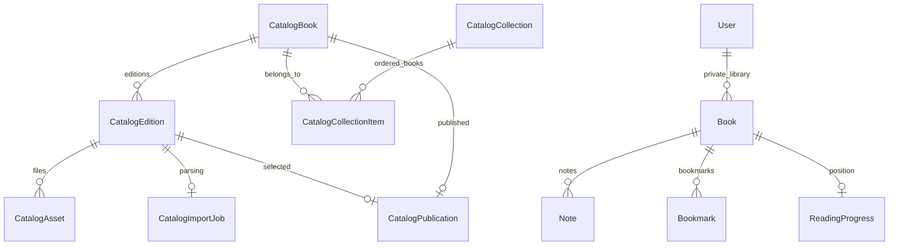

# Public bookstore and platform translation

The public catalog is separate from users' private book libraries. `/admin` requires a web session whose User.isAdmin is true. Public browsing and book download do not require an account. Translation requires a signed-in account and uses the server's AI_BASE_URL, AI_MODEL and AI_API_KEY. No user-supplied provider or key is accepted by the hosted service; personal translation instructions remain editable.

A downloaded book uses its immutable catalog edition ID as the local/private Book.id. The file is a complete validated reading-core Book, including supported images, TOC and references. An updated upload creates a new edition, preserving existing reader copies and paragraph anchors. Metadata edits apply to new downloads. Unpublishing removes public access without deleting users' copies. There is no billing or rights approval workflow.

## Admin workflow

1. Save title, author, URL slug, language, category and description. Source link is optional.
2. Upload EPUB, text-layer PDF or UTF-8 TXT (30 MB maximum).
3. A persistent database queue parses the source into a reading bundle. Worker leases recover interrupted jobs; failed jobs can be explicitly retried. PDF OCR is not performed on the server. Parsing warnings remain visible.
4. Preview chapters, then publish the ready edition. Draft source files are never publicly accessible.
5. Create collections, select books in display order and save. Only published books appear in the public collection.

Object storage uses the private GCS bucket configured by CATALOG_BUCKET. The runtime service account has bucket-scoped object permissions. Database rows retain file size and SHA-256, checked before delivery; clients validate size, hash, book schema and edition identity before writing their local library. There is no public upload or bootstrap endpoint.

## Initial content

`scripts/publish-classics.ts` downloads complete EPUB editions from the official Project Gutenberg pages for Pride and Prejudice (1342), Alice's Adventures in Wonderland (11), Frankenstein (84) and The Adventures of Sherlock Holmes (1661). Original credits and license text remain inside the reading bundle. These entries are marked public domain in the USA by their source catalog. Source links provide the original formats.

Run `NODE_OPTIONS=--conditions=react-server npx tsx scripts/publish-classics.ts` to prepare local publication previews; add `--publish` with operator-provided DATABASE_URL and CATALOG_BUCKET to import and publish. The script is idempotent for already-published entries. It does not grant admin privileges or embed credentials.

## Mobile translation

Downloaded books enter the existing local library. Web and native use the same authenticated `/api/translations` endpoint, edition records, chapter queue and server worker. Readers choose a chapter or the whole book once. A database lease and chunk checkpoints allow work to continue through screen changes, backgrounding and app closure. Pausing is an explicit server action; opening an app does not resume a paused or failed task.

The source snapshot belongs to the translation edition and the signed-in user, independently of library synchronization. Starting translation submits only reading text and metadata, never images, PDF originals, notes or bookmarks. Existing editions and checkpoints are preserved by the migration. Deleting the account cascades through its source snapshots, editions and selections.

Native caches manifests by account and library, downloads complete validated chapters, and atomically stores immutable published paragraph versions. Source hashes prevent mismatched editions; account and library guards prevent late writes after switching. Completed downloads remain readable offline and old saved notes keep their exact translation keys. New editions replace the displayed one only after explicit selection. There is no foreground paragraph runner, batch cap, old mobile translation endpoint or billing.

The iOS storefront requires the updated app binary. Existing native translation endpoints use the platform configuration as soon as the server deploys. Keys stay server-side. Complete exceptions, upstream error responses and request correlation remain in protected logs; privacy disclosures describe this processing.

Validation for this change is type checking, production builds and static review. No unit, integration or end-to-end automation was run, following the user's preference.
